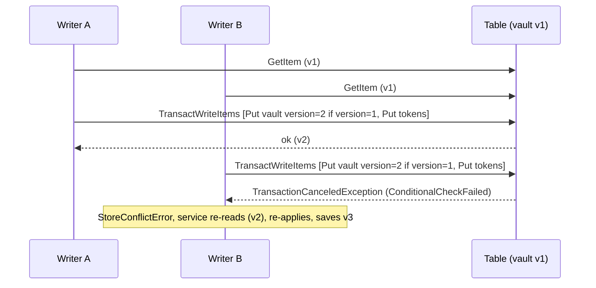

# Design: AWS Release Runtime

## Overview

A second production runtime beside the Cloudflare Worker. It fills the same ports and reuses `createApp(deps)` and `step` untouched.

| Port | Cloudflare Worker | AWS runtime |
|---|---|---|
| `Clock` | `SystemClock` | `SystemClock` |
| `VaultStore` | `KvStore` | `DynamoDBStore` |
| `Mailer` | `ResendMailer` | `SesMailer` |
| `RateLimiter` | binding or memory | `MemoryRateLimiter` (per container) |
| Tick | Cron Trigger, 15 min | EventBridge Scheduler `rate(15 minutes)` |
| Entry | `src/worker/index.ts` | `src/aws/http.ts`, `src/aws/tick.ts`, `src/aws/config.ts` |

This session builds only the store layer (requirements 1 to 3, 9). The rest is in tasks.md.

## Closing task 8.1 for this runtime

Task 8.1 of switch-lifecycle asks for a Durable Object per vigil to serialise concurrent writes. `SwitchService.exclusive` serialises writes inside one process only. Lambda runs many containers, and the scheduled tick runs in its own, so two writers can load the same vault and the second `put` overwrites the first (a check-in lost under a witness denial, or the reverse). On AWS this is closed by optimistic concurrency in the store: every save is conditional on the version it read, so the loser fails instead of overwriting. Requirement 4 makes `SwitchService` retry the loser. Task 8.1 stays open for the Cloudflare Worker, where `KvStore` has no condition.

## Components

### `DynamoDBStore` (`src/server/adapters/dynamodb-store.ts`)
Implements `VaultStore`. Takes a `DynamoDocLike` client and a table name.

- `get(id)`: `GetItem` on `vault#<id>` with `ConsistentRead: true`. On a hit it remembers `{ version, tokens }` for the id (the tokens the stored vault held) and returns the parsed `data`.
- `put(vault)`: see the flow below.
- `findByToken(kind, hash)`: strongly consistent `GetItem` on `tok#<kind>#<hash>`, returns `vaultId` or null.
- `listIds()`: `Scan` with `ConsistentRead`, `FilterExpression: begins_with(pk, :p)`, `ProjectionExpression: pk`, following `LastEvaluatedKey`.

The remembered versions live in a per-instance `Map`. The `VaultStore` interface is unchanged: `SwitchService` always reads then saves through one store instance, so the read is the point where the version is learned.

### `StoreConflictError` (`src/server/ports.ts`)
Part of the port contract. Thrown only by stores that can detect a concurrent write. `MemoryStore` and `KvStore` never throw it.

### `DynamoDocLike` (local client interface)
Method-style, native JavaScript values, shaped after the DocumentClient commands in `@aws-sdk/lib-dynamodb` (`GetCommand`, `TransactWriteCommand`, `DeleteCommand`, `ScanCommand`). A thin wrapper over the real client is a later task; it is the only code that imports an SDK package, and no AWS SDK package is installed in this session.

```ts
interface DynamoDocLike {
  get(i: { TableName: string; Key: { pk: string }; ConsistentRead: boolean }): Promise<{ Item?: Record<string, unknown> }>;
  transactWrite(i: { TransactItems: TransactItem[] }): Promise<unknown>;
  delete(i: { TableName: string; Key: { pk: string } }): Promise<unknown>;
  scan(i: ScanInput): Promise<{ Items?: Record<string, unknown>[]; LastEvaluatedKey?: Record<string, unknown> }>;
}
```

### Built in session 14
- Retry: `SwitchService.runNow` repeats `runOnce` (load, tick, mutate, save, mail) on `StoreConflictError`, up to `MAX_SAVE_ATTEMPTS` (3), then throws `HttpError(409)`. Mail follows the save, so a discarded attempt sends none.
- `SesMailer` takes a `SesClientLike { sendEmail(input) }` shaped like SES v2 `SendEmail`. Errors carry only the SES error name.

### Later components (not built yet)
`src/aws/config.ts`, `src/aws/http.ts` (`handle(createApp(...))` from `@hono/aws-lambda`, a separate package from `hono`), `src/aws/tick.ts`, a `rate(15 minutes)` schedule description, and the retry in `SwitchService`.

## Data model

One table, partition key `pk` (string), no sort key. On-demand billing is assumed.

| Item | `pk` | Attributes |
|---|---|---|
| Vault | `vault#<id>` | `kind: "vault"`, `version: N`, `data: <vault JSON string>` |
| Token index | `tok#<kind>#<hash>` | `kind: "token"`, `vaultId` |

Storing the vault as one JSON string keeps the item opaque to DynamoDB (no per-attribute cost, no attribute-name reserved words) and matches `KvStore`.

Item limit: DynamoDB rejects an item over 400 KB (TransactWriteItems page). The domain allows 50 letters of up to 400,000 characters each, so a vault can exceed it. The store refuses a vault whose JSON exceeds 390,000 bytes, leaving room for attribute names and the other attributes, and throws a plain error. Splitting letters into their own items is a known follow-up and is not built; vaults with a few ordinary letters sit far below the limit.

## Conditional-write flow



`put(vault)`:
1. Serialise. Over 390,000 bytes: throw (Req 1.5).
2. Look up the remembered `{ version, tokens }`. If present, the condition is `#v = :read` (`#v` names `version`) and the new version is `read + 1`. If absent, the condition is `attribute_not_exists(pk)` and the new version is 1. (`attribute_not_exists` on the partition key is the documented way to stop a put replacing an existing item; PutItem page.)
3. Send one `TransactWriteItems` whose first action is the conditional `Put` of the vault and whose other actions are one unconditional `Put` per current token key. Count at most 1 + 10 witnesses + 50 letters + 6 check-in links + 1 owner, under the 100-action cap. All are different items, as the API requires.
4. On success, remember `{ version: new, tokens: current }`, then delete each token the vault held at read time and no longer holds, one `DeleteItem` at a time, ignoring failures (Req 3.5).
5. On failure, classify (below).

Why a transaction and not a single `PutItem`: the index items must change in the same instant as the vault, or a crash between writes leaves a witness link pointing nowhere. `TransactWriteItems` is all-or-nothing.

## Error handling

- A failed condition inside a transaction surfaces as `TransactionCanceledException` with `CancellationReasons`, ordered like `TransactItems`. The vault `Put` is item 0. If reason 0 has `Code` `ConditionalCheckFailed`, or a code of `TransactionConflict` (an ongoing transaction on the same item), the store throws `StoreConflictError` and forgets the remembered version.
- The code string `ConditionalCheckFailed` appears in the capacity-management section of the Transactions page. The string `TransactionConflict` as a cancellation code was not confirmed in any page read; the store treats it as a conflict anyway, because both mean "someone else is writing this vault and a retry is correct".
- A non-transaction `PutItem` or `DeleteItem` that hits a conflicting transaction fails with `TransactionConflictException`. The store never issues those against vault items, but it also maps that error name to a conflict for safety.
- `TransactionCanceledException` for any other reason (capacity, validation, size) is rethrown unchanged (Req 2.7).
- AWS SDKs do not retry a `TransactionCanceledException`, so the retry belongs in `SwitchService` (Requirement 4). Three attempts bound the loop; the third failure is a 409.
- Idempotency token: `ClientRequestToken` is not used. A retry after a conflict re-reads and re-applies, so it is a new request by design.

## Testing strategy

- `tests/unit/fake-dynamo.ts`: an in-memory `DynamoDocLike`. It evaluates only the two condition forms the store emits and throws on any other, checks every condition before applying any action (atomic), throws a `TransactionCanceledException`-shaped error with ordered `CancellationReasons`, and can yield before `get` so two writers interleave, or inject a failure.
- `tests/unit/dynamodb-store.test.ts`: get miss and hit, versions, index kept in step, stale deletion and its failure, `listIds` across pages, size refusal, non-conflict errors rethrown, create over an existing id, **two writers racing so exactly one wins**, retry after a conflict, one transaction of at most 100 actions, no index written on a failed condition.
- No network, no SDK package, no AWS credentials.

## Sources checked

Read through the aws-docs MCP server (`search_documentation`, `read_documentation`):

- "PutItem" (API Reference): `ConditionExpression`, `attribute_not_exists` on the partition key to avoid replacing an item.
- "TransactWriteItems" (API Reference): up to 100 actions, one action per item, atomic, aggregate 4 MB, item over 400 KB rejected, rejection when a condition fails or another operation is updating the same item.
- "CancellationReason" (API Reference): the list is ordered like `TransactItems`; each entry has `Code`, `Message`, `Item`.
- "Amazon DynamoDB transactions: How it works" (Developer Guide, `transaction-apis.html`; section "Error handling for writing" and "Transaction conflict handling in DynamoDB"): `TransactionCanceledException`, `TransactionConflictException` for single-item writes, SDKs do not retry a cancelled transaction, `ConditionalCheckFailed` as a cancellation reason, client-token idempotency window.
- "SendEmail" (SES API Reference v2): `Content.Simple.{Subject, Body.Html, Body.Text}` with `Charset` and `Data`, `Destination.ToAddresses`, `FromEmailAddress` (must be verified), optional `ConfigurationSetName`.
- "Schedule types in EventBridge Scheduler" (User Guide): `rate(value unit)` with units minutes, hours or days; 60-second precision.
- "Invoke a Lambda Event Function on a schedule" (Lambda Developer Guide): asynchronous invoke, needs an execution role.

Read through context7 (`/honojs/website`): the Lambda adapter is `handle` from `@hono/aws-lambda` (a separate package), exported as `handler`; the Lambda event and context are available as `c.env.event` and `c.env.lambdaContext`.

Not confirmed from the pages read: the full `SendEmail` error list (see Error handling for the cancellation code).

## Deliberately not built

- No deployment, no IaC written or applied, no IAM roles or policies, no table creation.
- No AWS SDK package installed and no real AWS call from the code or the tests.
- No shared rate limiter on AWS; no splitting of large vaults across items.
- No change to the Worker, `KvStore`, or switch-lifecycle task 8.1 (it stays open for the Worker).
- No DynamoDB TTL, streams or backups.
