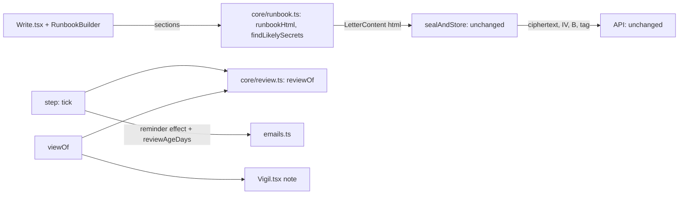

# Design: Founder Runbook

## Overview

Two small features on top of the switch-lifecycle design. Neither adds a port, a route, a stored field or a vault state.

1. **Template** (browser only). `src/core/runbook.ts` holds the account kinds, builds the letter HTML from sections, and detects likely secrets. The writing desk (`Write.tsx`) gets a template choice and a `RunbookBuilder` component. Sealing is unchanged: `sealAndStore` receives ordinary `LetterContent`.
2. **Yearly nudge** (pure core, mail effect, view). `src/core/review.ts` derives the review age from the vault's letters. The pure machine adds it to the existing `reminder` effect. `emails.ts` renders one extra line. `viewOf` returns it to the vigil page.

## Components

### `src/core/runbook.ts` (pure, no I/O, imports nothing outside `core/`)
- `ACCOUNT_KINDS`: `{ id, title, placeholders }` for `cloud`, `registrar`, `payments`, `bank`, `password-manager`, in that order. Titles: "Cloud root account", "Domain registrar", "Payments and contractor payouts", "Bank", "The password manager itself".
- `RunbookSection { kind, where, who, due }`. `newRunbook()` returns one empty section per kind. `addSection(sections, kind)` appends if absent. `removeSection(sections, kind)` drops one.
- `runbookHtml(sections)`: for each section an `<h2>` and a `<ul>` of the filled fields, labelled "Where the login and recovery codes live:", "Who to call:", "Renews or is due:". Values are HTML-escaped. Empty fields are omitted; a section with no fields gets only its heading. Tags used: `h2`, `ul`, `li`, `strong`, `p`. No attributes.
- `runbookIsBlank(sections)`: true when every field of every section is blank.
- `RUNBOOK_WARNING`: the plain-words text shown above the first section (Req 2.1).
- `findLikelySecrets(text)`: returns `{ line, kind, preview }[]`. `preview` is the first three characters of the match followed by an ellipsis. Rules: (a) labelled value, `/\b(password|passcode|passwd|pin|secret|recovery code|backup code|api key|token)s?\s*[:=]\s*\S+/i`; (b) a run of 20+ characters from `[A-Za-z0-9_\-+/=]` with at least one letter and one digit, skipping anything that starts with `http` or contains `@`; (c) three or more hyphen-separated groups of 4 to 6 alphanumerics with at least one digit. The function takes plain text; the page strips tags and puts a newline at each block end first.

### `src/core/review.ts` (pure)
- `REVIEW_AFTER_DAYS = 365`.
- `reviewOf(vault, now) -> { oldestSealedAt, ageDays, years, days } | null`. Considers letters with `sealed !== null` and `releasedAt === null`. Null when none, when `vault.state === 'released'`, or when the oldest is under 365 days old.

### `src/core/machine.ts`
The `reminder` effect gains an optional `reviewAgeDays?: number`. In `runTick`, when the reminder is emitted, `reviewOf(vault, ctx.now)` supplies it. Nothing else changes: no new state, no new `sent` key, no new history kind. The existing `once('reminder')` already makes the email at most once per cycle, so Req 5.10 holds without new code.

Reminders fire once per check-in cycle. An author who checks in every month receives a reminder each cycle, so the line reaches them within one cadence of the letter turning a year old.

### `src/server/emails.ts`
The `reminder` draft appends one line when `reviewAgeDays` is set: "Your oldest letter was sealed N year(s) and D day(s) ago. Please open your vigil and review your letters: accounts, phone numbers and renewal dates change." Templates for witnesses and recipients are untouched.

### `src/core/vault.ts`
`VaultView.review: { oldestSealedAt, ageDays, years, days } | null` is set from `reviewOf(vault, now)`. `viewOf` already receives `now`. Nothing is stored.

### Web
- `components/RunbookBuilder.tsx`: the warning paragraph, one `<fieldset>` per section (legend = title, three labelled inputs), a "Remove this section" button per section, an "Add a section" select and button listing absent kinds. Reports `sections` upward; `Write.tsx` derives the HTML with `runbookHtml`.
- `components/SecretWarning.tsx`: the in-theme warning (class `warning`) in a `role="status"` region with text: "This looks like a password or a code on line N (“abc…”). Write where it is kept, not the secret itself. You can still seal." Always present in the DOM so announcements work; empty when there are no findings.
- `pages/Write.tsx`: two buttons in a `role="group"` (pressed state via `aria-pressed`) choose the mode. In runbook mode the `Editor` is replaced by the builder. The draft text for the check is the runbook text or the editor text. Sealing is never blocked by findings.
- `pages/Vigil.tsx`: when `vault.review` is set, a `section` with an `h2` "Review your letters" and text "Your oldest letter was sealed 1 year and 3 days ago. Open the writing desk to check it still tells the truth." It is a labelled section (`aria-labelledby`), and changes no candle or state.
- `lib/seal.ts`: `FOUNDER_DEMO`'s first letter uses `runbookHtml` over four filled sections. The letter keeps the title, sign-off and vault custody.

## Data

No new stored data. `Vault`, `Letter` and the API are unchanged. The only new fields are `reviewAgeDays` on the in-memory `reminder` effect and `review` on `VaultView`.

## Ports and the state machine

- No new port. The mail effect goes through the existing `Mailer`; the clock is the existing `Clock`, so the time machine reaches the nudge by moving `now`.
- The machine stays pure. `reviewOf` takes `now` from `MachineContext`. Tick stays idempotent.
- The nudge only decorates an effect the machine already emits. It cannot release, deny, pause or move a state.

## Error handling

- Blank runbook: "The page is still blank. Write where one account lives before sealing." in the existing `role="alert"` form error.
- Secret warnings never block and never throw; if the check fails for any reason the page seals as normal.
- A missing or malformed `reviewAgeDays` renders no line.

## Security and privacy

- The check and the template run only in the browser. Nothing is logged. The seal path is the one in `crypto.md`, untouched.
- Section kinds and field names exist only inside the sealed HTML. The upload has no template field.
- The review line carries an age, not letter content, and goes only to the author.

## Accessibility

Fields have visible labels; the warning is text in a polite status region; the review note is text; buttons are keyboard operable with the ember focus ring; the new page states are added to the axe audit.

## Testing strategy

- `tests/unit/runbook.test.ts`: section order, fields, add/remove, HTML escaping, empty-field omission, allow-list round trip with `sanitizeLetterHtml`, each secret rule, prose that must not warn, Priya's letter.
- `tests/unit/review.test.ts`: `reviewOf` boundary at 364/365 days, released and opened letters ignored, oldest letter wins, burn recomputes; the machine adds `reviewAgeDays` only to the reminder and changes no state, history or `sent` key compared with a vault with no old letters; no effect to witnesses or recipients; idempotent tick; the reminder email text with and without the line; `viewOf.review`.
- `tests/unit/founder-demo.test.ts`: Priya's letter (sections, March, no payroll, no findings, custody).
- `tests/e2e/runbook.spec.ts`: template choice, sections, add/remove, warning text, non-blocking seal, upload body has no plaintext, founder demo letter, time machine reaches the note, axe on the new states (the audits live in this file, so the runbook states are audited where they are built).
