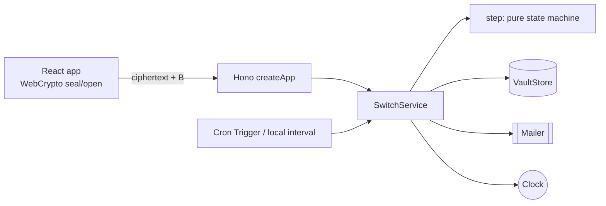
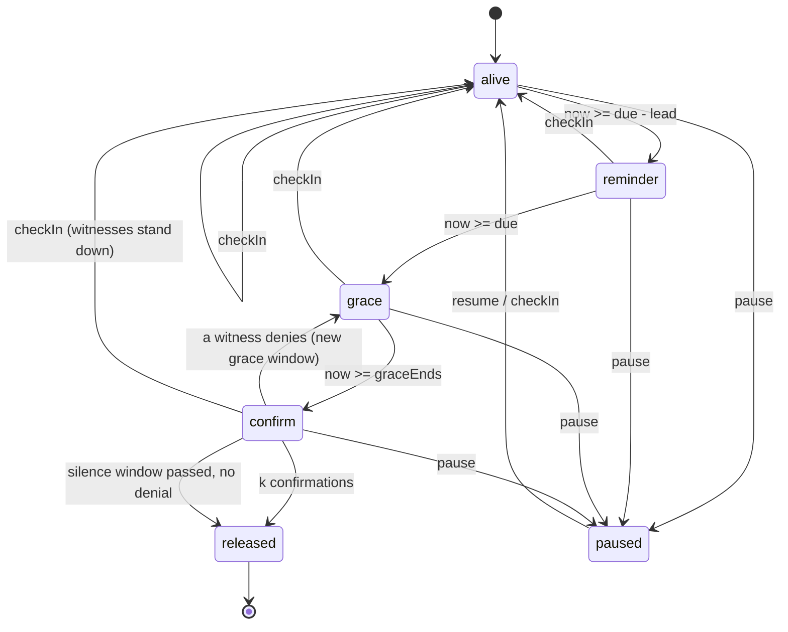

# Design: Switch Lifecycle

## Overview

One TypeScript codebase, three layers:

1. **Core** (`src/core`): pure domain code shared by every runtime. The state machine, schedule maths, crypto and validation. No I/O.
2. **Server** (`src/server`): a Hono app built by `createApp(deps)`, a `SwitchService` that orchestrates use-cases, and adapters behind four ports (`Clock`, `VaultStore`, `Mailer`, `RateLimiter`).
3. **Web** (`src/web`): a React app that seals and opens letters with WebCrypto and talks to the API.

The same `createApp` runs on Node for local use and on a Cloudflare Worker in production.



## Ports and adapters

| Port | Local (default) | Production (written, type-checked) |
|---|---|---|
| `Clock` | `MachineClock`: wall time plus a forward-only offset (the time machine) | `SystemClock` |
| `VaultStore` | `MemoryStore`, optionally persisted to `data/vaults.json` | `KvStore` on Workers KV |
| `Mailer` | `OutboxMailer`: an in-memory list persisted to `data/outbox.json` | `ResendMailer` over HTTPS |
| `RateLimiter` | `MemoryRateLimiter`: fixed window in a `Map`, per process or isolate | `CloudflareRateLimiter` wrapping the Workers Rate Limiting binding (optional) |

Selection is by env var in `src/server/node.ts` (`DMS_CLOCK`, `DMS_STORE`, `DMS_MAILER`). The Worker in `src/worker/index.ts` always uses the production adapters for `Clock`, `VaultStore` and `Mailer`. For `RateLimiter`, `selectRateLimiter(env)` uses `CloudflareRateLimiter` only when the optional `DMS_RATE_LIMITER` binding is present (it is commented out in `wrangler.toml`) and `MemoryRateLimiter` otherwise. Dev routes (`/api/dev/*`) exist only when both the machine clock and the outbox are in use. The machine clock is opt-in (`--time-machine` or `DMS_CLOCK=machine`; `npm run demo` and `npm run dev` pass it), and the Node entry refuses to start it when `DMS_BASE_URL` is not a localhost origin.

## State machine

`step(vault, event, { now, mint }) -> { vault, effects, changed }` is pure. `mint` returns a fresh token and its hash and is injected so the function stays deterministic in tests. Effects are data (`{ type: 'email', template, to, ... }`); the service performs them after saving.



Schedule (derived, never stored):
- `dueAt = lastCheckInAt + cadenceDays`
- `reminderAt = dueAt - min(reminderLeadDays, cadenceDays)`
- `graceEndsAt = graceEndsOverride ?? dueAt + graceDays` (the override is set by a witness denial)
- `lastCallAt = max(graceEndsAt - 1 day, dueAt)`
- `silenceReleaseAt = confirmStartedAt + silenceReleaseDays` (null when disabled)

Idempotence: each reminder is recorded in `vault.sent` under a key scoped by cycle and confirm round (`c3:r1:last-call`). A tick loops until stable (at most 10 passes), so a long outage cascades through every due stage in one run. `confirmStartedAt` is the moment witnesses were actually asked, never a back-dated threshold, so an outage can never shorten the silence window.

Events and guards:
- `checkIn`: any state but `released`. Resets cycle, reminders, overrides and witness responses.
- `pause`: counts as a check-in, then `paused`. `resume`: `paused` -> `alive` with a fresh cycle.
- `witnessConfirm` / `witnessDeny`: only in `confirm`, once per witness per round.
- Anything on `released` throws `SwitchError('released')`.

## Data model

```ts
Vault {
  id, ownerTokenHash, author: { name, email }, settings,
  state, stateSince, lastCheckInAt, cycle, graceEndsOverride, confirmStartedAt, confirmRound,
  releasedAt, sent: string[], witnesses: Witness[], letters: Letter[], history: HistoryEntry[], createdAt
}
Witness { id, name, email, tokenHash | null, response: pending | confirmed | denied, respondedAt, addedAt }
Letter  { id, recipient, custody: keepsake | vault, sealedAt, sealed: SealedLetter | null, openTokenHash | null, releasedAt, openedAt }
SealedLetter { ciphertext, iv, vaultHalf, keepsakeTag, keepsakeHalf? }   // keepsakeHalf only in vault custody
```

All tokens (owner, witness, open) are 32 random bytes in base64url; only SHA-256 hashes are stored. The store keeps an index `tok:<kind>:<hash> -> vaultId`, maintained on every `put`.

## Crypto scheme

Per letter, in the author's browser:
1. `K <- random(32)`, `A <- random(32)`, `B = K xor A`, `IV <- random(12)`.
2. `C = AES-GCM-256(K, IV, plaintext = JSON{format, title, html, from}, AAD = "dms-letter-v1:" + letterId)`.
3. Upload `{ C, IV, B, tag = SHA-256("dms-letter-v1:keepsake:" + A) }`. In vault custody also upload `A`.
4. Zero `K` and `A` buffers after use. Keep `A` in the author's localStorage so the keepsake can be copied again.

At release, in the recipient's browser:
1. `GET /api/open/:token` returns metadata and the tag (does not spend the link).
2. The browser gets `A` from the link fragment (vault custody), from localStorage (keepsake visited earlier), or from the pasted link or typed base32 code. It checks `SHA-256(A)` against the tag first, so a wrong keepsake never spends the link.
3. `POST /api/open/:token/break` returns `{ C, IV, B }` once and deletes the sealed copy.
4. `K = A xor B`; decrypt; sanitise with DOMPurify; render.

Honest limits (also on `/how-it-works`):
- Vault custody: the operator could read those letters.
- A compromised author device can read letters while they are written.
- Anyone with both the release email and the keepsake can open the letter.
- Colluding witnesses can release early; require more than one if that matters.
- The server sees metadata: names, emails, timing and ciphertext sizes.
- Browser crypto trusts the served code; a malicious deploy could exfiltrate letters as they are written.

## HTTP API

| Method | Path | Auth | Purpose |
|---|---|---|---|
| POST | `/api/vaults` | none | create a vigil, returns `ownerToken` once |
| GET | `/api/vault` | owner | the author's view (ticks first) |
| POST | `/api/vault/check-in` \| `pause` \| `resume` | owner | lifecycle events |
| PATCH | `/api/vault/settings` | owner | change cadence, grace, lead, k, silence |
| POST/DELETE | `/api/vault/witnesses[/:id]` | owner | name or remove a witness |
| POST/DELETE | `/api/vault/letters[/:id]` | owner | add a sealed letter or burn one |
| GET/POST | `/api/witness/:token` | witness link | read the summons, answer confirm or deny |
| GET | `/api/open/:token` | open link | letter metadata, does not spend the link |
| POST | `/api/open/:token/break` | open link | one-time hand-over of the sealed copy |
| GET/POST/DELETE | `/api/dev/clock`, `/api/dev/outbox`, `/api/dev/reset` | local only | time machine and outbox |

Errors are JSON `{ error }`: 400 validation, 401 owner token, 404 unknown link, 409 state conflict, 410 spent link, 429 too many requests.

### Response hardening

- Every response (API, HTML and, on the Worker, static assets) carries `Content-Security-Policy` (`script-src 'self'`, `object-src 'none'`, `base-uri 'none'`, `frame-ancestors 'none'`, same-origin connect, font and image sources), `X-Frame-Options: DENY`, `X-Content-Type-Options: nosniff`, `Referrer-Policy: no-referrer`, a closed `Permissions-Policy` and `Cross-Origin-Opener-Policy: same-origin`. This backs up DOMPurify: a sanitiser miss in a released letter still cannot run script or reach another origin. Defined once in `src/server/security.ts`.
- `/api/witness/*` and `/api/open/*` are rate-limited per client through the `RateLimiter` port (`hit(key, now) -> { allowed, retryAfterSec }`; 60 requests a minute by default; 429 with the same JSON message and `Retry-After`). The key is the Cloudflare connecting IP on the Worker and the socket address on Node (`DMS_TRUST_PROXY=1` uses `X-Forwarded-For`). The default `MemoryRateLimiter` is a fixed window held in memory, so a restart or a new isolate resets it. With the optional Workers Rate Limiting binding, `CloudflareRateLimiter` asks the binding (`limit({ key }) -> { success }`), which the platform shares across isolates; the limit and period (10 or 60 seconds) are set in `wrangler.toml`, `Retry-After` is that period, and a binding error lets the request through so a limiter outage cannot lock out witnesses. The 256-bit tokens remain the real defence.

## Service flow

`transact(vaultId, mutate)`: load, tick to `now`, apply the mutation, save, then send mail. Mail failures are written to the vigil's ledger rather than thrown, so a mail outage never loses a state change. Saving before sending means a crash between the two can drop an email but never duplicate a release.

## User interface

- **Landing**: hero candle, the rite in three parts, "Light the candle" form, and "Try a demo vigil" (invented people, two letters, two witnesses).
- **Vigil**: an SVG candle whose wax height is the share of the cadence left; the flame shortens in `reminder`, gutters in `grace`, smokes in `confirm`, is out in `released`, and sits under a glass cloche when `paused`. Beside it: a plain-language title, deadlines with dates and relative times, the wax-seal check-in button, a five-step stage track, letters as envelopes, witnesses, terms and the ledger.
- **Writing desk**: parchment editor, recipient fields, custody choice with plain trade-offs, a wax stamp that presses on seal, then the keepsake card (code, link, copy, email-it-yourself, print).
- **Witness page**: who named them, when the author last checked in, a two-step confirm and a one-tap "they still live".
- **Keepsake page**: explains the keepsake, remembers it locally, shows the code to print.
- **Open page**: a hovering envelope with a wax seal; enter keepsake if needed; the seal cracks, the flap opens and the letter unfolds; download and print.
- **Time machine drawer** (local only): simulated date, +1/+7/+30 days, skip to next event, outbox with clickable links.

Design tokens live on `:root`: night `#0c0908`, parchment `#efe3c8`, oxblood wax `#8e1b1b`, brass `#c9a45c`, flame `#ffcf7a`. Type: Cinzel Decorative for display, Cormorant Garamond for body, IM Fell English for handwriting. `prefers-reduced-motion` disables all animation.

## Error handling

Every route validates input and returns a message that says what to do. The UI shows errors in `role="alert"` regions and never loses a typed letter on failure. A 401 on the vigil clears the stored owner token and returns to the landing page.

## Testing strategy

- `tests/unit/machine.test.ts`: every transition, every cancel path, k-of-n, silence window, denial round, pause, idempotence, cascade, guards, purity.
- `tests/unit/crypto.test.ts`: round trip, no plaintext or key in stored data, fresh IV and key, wrong half, zero half, tamper, AAD binding, malformed keepsakes, keepsake tag, base32 handwriting tolerance.
- `tests/unit/api.test.ts`: the full lifecycle through HTTP with both custody modes, one-time opening, stand-down, denial, next-event jump, pause, validation and auth.
- `tests/e2e/*.spec.ts` (Playwright against the built server): write a letter, fast-forward, witness confirms in a separate browser, recipient opens with a pasted keepsake in a fresh browser, link refuses a second opening; check-in during grace; vault-custody link; landing and honest-page smoke tests on desktop and mobile; the lifecycle run also asserts the CSP header and that no CSP violation is reported in the author's or the recipient's browser.
- `tests/unit/security.test.ts`: security headers on every response, the token-route rate limit, and that dev routes are absent without the local adapters.
- `tests/unit/rate-limiter.test.ts`: the memory window limits and resets; the Cloudflare adapter maps `success: false` to a blocked decision and a 429 through the middleware, and fails open. `tests/unit/adapters.test.ts` also checks that the Worker picks the binding when present and memory when absent.
- `tests/unit/wax-seal.test.ts`: a seal mark is drawn as exactly one text glyph and the SVG stays `aria-hidden`.
- `tests/unit/node-entry.test.ts` (CLI): the Node entry starts without the time machine by default, enables it only on request, and refuses it for a public origin.
