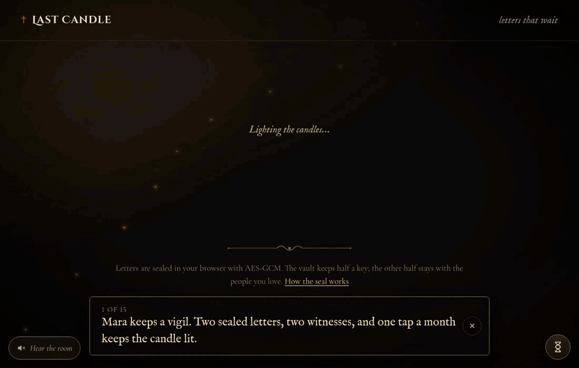
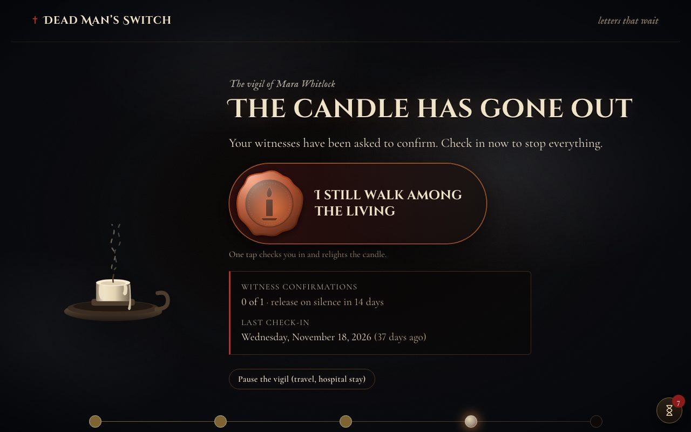

# Dead Man's Switch

**Write letters for the people you love, sealed until you can no longer check in.**

[](https://github.com/blackwingArtisan/dead-mans-switch/actions/workflows/ci.yml)



[Judge's 60-second path](#judges-60-second-path) · [Why not Google or Apple?](#why-not-the-tools-you-already-have) · [How the seal works](#the-seal) · [Built with Kiro](#built-with-kiro) · [Kiro log](KIRO-LOG.md) · [Spec](.kiro/specs/switch-lifecycle)

**[46% of U.S. adults have a will](https://news.gallup.com/poll/351500/how-many-americans-have-will.aspx)** (Gallup, 2021). Not one of those wills tells your sister where the password sheet is.

A candle-lit vigil for your last words. Letters are encrypted in your browser. You keep a candle lit with one tap ("I still walk among the living"). If it ever goes out, you get reminders and a grace period; then the people you trust are asked to confirm; only then does each recipient get a one-time link that decrypts their letter in their own browser.

Built for Kiroween 2026, Costume Contest category.

> ### Judge's 60-second path
>
> 1. `npm install && npm run demo`, open http://localhost:3140 and press **Try a demo vigil**. You are Mara, with two sealed letters and two witnesses.
> 2. Open the **Time machine** (hourglass, bottom right) and press **+30 days**. The flame gutters and the grace email lands in the outbox.
> 3. Press **+7 days**. The candle goes out and the witnesses are asked. In the outbox, open **Witness asked** and confirm as Silas.
> 4. Open **Letter released** for June and break the seal. The letter decrypts in that browser tab, once. Move your cursor over the dark page to read it by candlelight.
>
> Or press **▶ Play the whole story** on the landing page: a captioned, hands-off run of all four steps in about 40 seconds.

## Who it is for

**Mara, 58.** Mara wants her son Theo to know the deed is in the blue tin and that she was proud of him, and her best friend June to know where the password sheet is and that Biscuit lies about being fed. She will not hand those letters over today. She checks in once a month from her phone; if she ever stops, her witnesses are asked first, and only then do Theo and June each get their own letter.

**Priya, a solo founder.** Priya is the only person holding the cloud root account, the domain registrar and the payroll login. A will does not cover that, and a shared password vault would hand everything over today. Her sealed letter tells her co-founder where each recovery code lives, released only if she goes quiet and her accountant, her named witness, confirms it. Press **or a founder's vigil** on the landing page to try hers.

## Why not the tools you already have?

| Tool | What it hands over | Who can read it first | Who checks before it goes | Works for |
|---|---|---|---|---|
| Google Inactive Account Manager | Google account data, plus one notice email | Google holds the data | No one: an inactivity timer decides | Google accounts only |
| Apple Legacy Contact | Apple account data | Apple holds the data | Apple, after a death certificate | Apple accounts only |
| Bitwarden Emergency Access | The whole password vault | No one (end-to-end encrypted) | Only you, by rejecting within a wait time | Bitwarden Premium users |
| deadmansswitch.net | Pre-written emails | Not stated on its site | No one: missed reminders release them | Any email address |
| **Dead Man's Switch** | **A sealed letter for each person, in your words** | **No one in keepsake custody: the recipient holds half the key** | **Witnesses you name; any one of them can stop it** | **Any browser, any email** |

The big platforms hand over accounts. This hands over the words, and even we cannot read them.

## The costume

| | |
|---|---|
|  |  |
|  |  |


The app wears its own state. The candle is the state machine, drawn, and the whole room follows it:

| Stage | What you see | What it means |
|---|---|---|
| Alive | A full candle, a steady flame, warm embers drifting | You checked in; nothing will be sent |
| Reminder | The wax burns down with the days left | Your check-in is due soon |
| Grace | The flame gutters, the glow halves, the brass tarnishes, the embers slow | You missed it; reminders keep coming |
| Witnesses asked | The candle is out and smoking; the room goes near black, cold and smoky | The people you trust are asked to confirm |
| Check-in | A match strike: the wick flares, the wax grows back, sparks leave the seal, the warmth returns | Everything is cancelled and the witnesses stand down |
| Released | A cracked seal, a moonlit room, and a letter read by the light of one candle | Each recipient opens their letter once |

Wax seals carry each recipient's initial, the check-in is a seal you press, and the recipient breaks a seal to read. Every one of these facts is also stated in text beside the candle and announced to screen readers; under reduced motion each change is instant and the letter opens fully lit.

<br clear="right">

## Beyond Kiroween

- **Free** for one vigil with a few letters, because everyone should be able to leave words behind.
- **Paid** at about $3 a month or $39 once, for more letters, more witnesses and a printed keepsake kit.
- **Referrers:** estate attorneys and hospice social workers already have this conversation every week and need something to hand over.
- **Teams:** a bus-factor plan for small companies, where the letter is the runbook for the accounts only one person holds.
- **Why now:** passkeys and account sprawl mean more of a life sits behind logins nobody else can open, and the free first-party tools hand over accounts, not words.
- **Next:** signed one-tap check-in links in every reminder, an AWS runtime (DynamoDB, SES, EventBridge) behind the same ports, and an optional Shamir split of the vault half across witnesses.

## What works today

- Begin a vigil with your own cadence, grace period, reminder lead, witnesses-required (k of n) and an optional silence window.
- Write rich-text letters on parchment; seal them with AES-GCM-256 in the browser.
- Two custody modes per letter:
  - **Keepsake** (default): the recipient holds half the key, handed over by you as a link or printed code. The server can never read the letter.
  - **Vault**: the server holds both halves, so there is nothing to hand over. The UI says plainly that the operator could read it.
- One-tap check-in, pause and resume.
- Reminder, grace, last-call, witness, stand-down, denial and release emails (plain text and HTML).
- Witness page with a two-step confirm and a one-tap "they still live" that stops the release.
- Recipient page: keepsake check before spending the link, the seal cracks, the letter unfolds; download and print; the server forgets its copy.
- **Time machine** (local only): move the clock forward a day, a week, a month or to the next event, and read every email in the outbox. The whole lifecycle runs in about a minute.
- **Play the whole story** (local only): a captioned, hands-off run from a lit candle to a letter read by candlelight.
- **The room follows the candle**: glow, embers, smoke, moonlight and palette change with the state, and a check-in relights it.
- **Read by their last candle**: the opened letter starts dark and a circle of light follows the reader's pointer or finger.
- **Two demo vigils**: Mara writing to her family, and Priya, a founder, writing to her co-founder about the accounts only she holds.
- A demo guide that says what to try next at each stage.
- An honest "How the seal works" page.

## Run it

Requires Node 20 or newer.

```bash
npm install
npm run demo          # builds the web app and serves everything on http://localhost:3140, time machine on
```

Then follow the [judge's 60-second path](#judges-60-second-path) above.

For development with hot reload: `npm run dev` (web on :3141, API on :3140, time machine on).

`npm start` runs the same server the way a deployment would: system clock, no time machine, no demo routes. The time machine is opt-in (`--time-machine` or `DMS_CLOCK=machine`) and the server refuses to start it for anything but a localhost origin.

Local data lives in `./data` (`vaults.json`, `outbox.json`, `clock.json`). Delete the folder or use **Reset the whole demo** to start over.

To refresh the README media, start `npm run demo` and run `node scripts/capture-media.mjs` (the GIF needs ffmpeg).

## Test it

```bash
npm test              # Vitest: state machine, crypto, full API lifecycle, security headers and rate limit, production adapters and Worker (with fakes), Node entry as a CLI
npm run e2e           # Playwright: builds and starts a fresh server on :3142 (or E2E_PORT), drives real browsers
npm run typecheck     # web + server, and the Cloudflare Worker against Workers types
npm run check         # all of the above plus a production build
```

The end-to-end suite writes a letter, fast-forwards past the grace period, confirms as a witness in a separate browser, opens the letter as the recipient in a fresh browser with a pasted keepsake, and checks the link refuses a second opening. It also covers a check-in during grace, a vault-custody link, the founder's demo, the hands-off story, in-theme form errors, the room relighting on check-in, mobile layout, and an axe WCAG 2.2 AA audit of every page and state.

GitHub Actions runs `npm run check` on every push and pull request ([`.github/workflows/ci.yml`](.github/workflows/ci.yml)).

## Architecture

```
src/core     pure domain: state machine, schedule, crypto, validation (shared everywhere)
src/server   Hono app (createApp), SwitchService, ports and adapters, email templates, Node entry
src/worker   Cloudflare Worker entry: fetch + Cron Trigger
src/web      React app: candle, wax seals, writing desk, witness, keepsake and recipient pages
tests/unit   Vitest
tests/e2e    Playwright
```

The state machine is a pure function, `step(vault, event, { now, mint }) -> { vault, effects }`. Effects are emails described as data; the service saves the vault first and then sends them. Ticks are idempotent and cascade, so a scheduler that was down for a month catches up in one run without double-sending.

States: `alive -> reminder -> grace -> confirm -> released`, plus `paused`. Check-in cancels from any live state; a witness denial sends `confirm` back to `grace` with a fresh grace window. Full detail in [`.kiro/specs/switch-lifecycle/design.md`](.kiro/specs/switch-lifecycle/design.md).

### The seal

Each letter gets a random key K. K is split into a keepsake half A (random) and a vault half B = K xor A. The server stores the ciphertext, B and a hash of A. At release the recipient's browser joins A and B and decrypts locally; the ciphertext is bound to the letter id so it cannot be swapped. Limits, stated plainly in the app: vault custody is readable by the operator; a compromised device can read letters as they are written; witnesses who collude can release early; the server sees names, emails and timing; browser crypto trusts the code it is served.

## Adapters

| Port | Local (default, free) | Real (written and type-checked, not run in tests) | Env |
|---|---|---|---|
| Clock | `MachineClock` (time machine, opt-in for demos) | `SystemClock` (default) | `DMS_CLOCK=machine\|system`, or `--time-machine` |
| Store | `MemoryStore` + JSON file | `KvStore` (Workers KV) | `DMS_STORE=file\|memory` |
| Mail | `OutboxMailer` (local outbox) | `ResendMailer` (HTTPS) | `DMS_MAILER=outbox\|resend` |

The time machine and outbox routes exist only when both local adapters are active.

## Deploy target (free, not deployed)

Cloudflare Workers free plan: static assets for the web app, one KV namespace, and a Cron Trigger every 15 minutes that ticks every vigil. Mail through Resend's free tier. See `wrangler.toml` and `src/worker/index.ts`. To deploy you would create the KV namespace, set its id in `wrangler.toml`, `wrangler secret put RESEND_API_KEY`, then `npm run build && wrangler deploy`.

## Built with Kiro

The initial build and the security hardening were done with Claude Code, working from the Kiro steering files and a spec written in Kiro's format. Kiro then reviewed the spec against the code, rewrote every criterion in EARS form, and built two tasks itself. Every call is in **[KIRO-LOG.md](KIRO-LOG.md)** with its prompt, duration, credits, files and test results.

| Kiro feature | Where | What it produced | Tests after |
|---|---|---|---|
| Spec review (Pass 2) | [`.kiro/specs/switch-lifecycle`](.kiro/specs/switch-lifecycle) | EARS criteria for Requirements 1 to 11, 12 new gap tasks, tasks checked only where a test exists | Vitest 79 of 79, Playwright 11 of 11, 0 axe violations |
| Spec-driven tasks (Pass 2) | `tasks.md` 8.6 and 6.11 | The `RateLimiter` port and both adapters; a single-glyph wax seal; three test files | Same run |
| Steering | [`.kiro/steering`](.kiro/steering) | Product, tech and structure rules every Kiro session reads first | n/a |
| Hooks | [`.kiro/hooks`](.kiro/hooks) | Unit tests on save, typecheck and tests before the agent stops, a crypto-custody review when `crypto.ts` changes | n/a |
| Prompts | [`.kiro/prompts`](.kiro/prompts) | The exact prompts, so each call can be re-run | n/a |

## Security headers and limits

Every response, including the Worker's static assets, carries a strict Content-Security-Policy (scripts from the same origin only, no plugins, no framing, same-origin network calls), `X-Frame-Options: DENY`, `nosniff`, `no-referrer` and a closed Permissions-Policy. The end-to-end run checks that the policy never blocks the app. Witness and letter links are rate-limited per client (60 a minute, then 429). The limiter lives in memory per process or isolate; a global limit would use a Durable Object.

## Accessibility

WCAG AA contrast on every text colour, full keyboard use with a skip link and visible ember-glow focus, every state and deadline stated in text beside the candle, status changes announced to screen readers, and `prefers-reduced-motion` turns off flicker, embers and seal animations.

## License

MIT © 2026 Stubborn Otter Software
