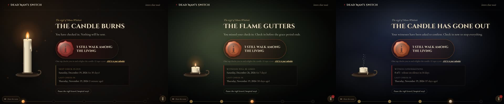
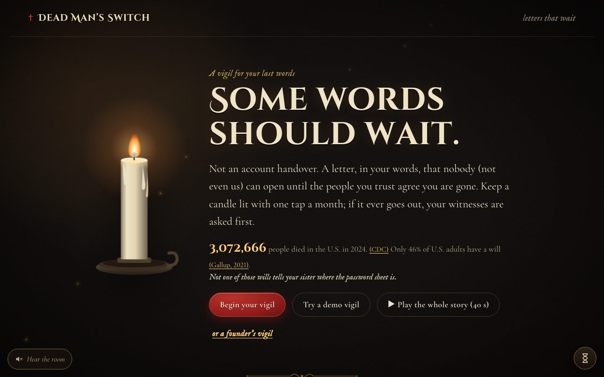
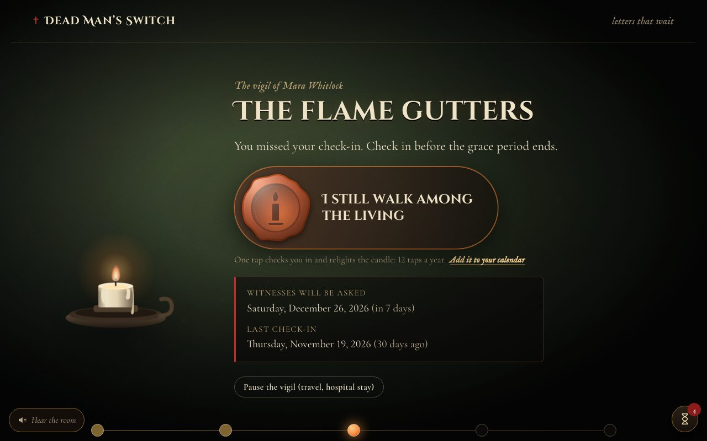
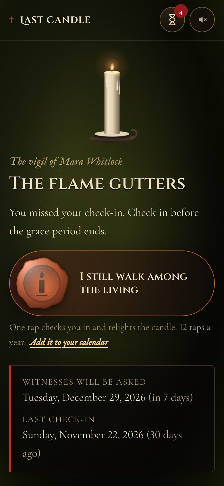

# Dead Man's Switch

**Write letters for the people you love, sealed until you can no longer check in.**

[](https://github.com/blackwingArtisan/dead-mans-switch/actions/workflows/ci.yml)


**Not an account handover. A letter, in your words, that nobody (not even us) can open until the people you trust agree you are gone.**

You keep a candle lit with one tap a month: twelve taps a year, and the vigil can put the reminder in your own calendar. If the candle ever goes out, you get reminders and a grace period; then your witnesses are asked to confirm; only then does each recipient get a one-time link that decrypts their letter in their own browser.

**Costume Contest: the candle is the state machine, and the whole room wears it.** Built for Kiroween 2026.



[Judge's 60-second path](#judges-60-second-path) · [Why not Google or Apple?](#why-not-the-tools-you-already-have) · [The costume](#the-costume) · [Built with Kiro](#built-with-kiro) · [Architecture](docs/ARCHITECTURE.md) · [Kiro log](KIRO-LOG.md) · [Changelog](CHANGELOG.md) · [Spec](.kiro/specs/switch-lifecycle)

> ### Judge's 60-second path
>
> 1. `npm install && npm run demo`, open http://localhost:3140 and press **Try a demo vigil**. You are Mara, with two sealed letters and two witnesses.
> 2. Open the **Time machine** (hourglass, bottom right) and press **+30 days**. The drawer steps aside, the flame gutters and the grace email lands in the outbox.
> 3. Open it again and press **+7 days**. The candle goes out and the witnesses are asked. In the outbox, open the first **Witness asked** and confirm as Silas.
> 4. Open **Letter released** for June and break the seal. The letter decrypts in that browser tab, once. Move your cursor over the dark page to read it by candlelight.
>
> Or press **▶ Play the whole story** on the landing page: a captioned, hands-off run of all four steps in about 40 seconds.

## Why it matters

- **[3,072,666 people died in the U.S. in 2024](https://www.cdc.gov/nchs/fastats/deaths.htm)** (CDC), and **[only 46% of U.S. adults have a will](https://news.gallup.com/poll/351500/how-many-americans-have-will.aspx)** (Gallup, 2021). Not one of those wills tells your sister where the password sheet is.
- **[29.8 million U.S. small businesses have no employees](https://advocacy.sba.gov/wp-content/uploads/2026/02/FINAL_FAQsAboutSmallBusiness_2026_012826.pdf)** (SBA Office of Advocacy, 2026, from 2022 data). In each one, a single person holds every account.
- **People already pay for a place to leave things behind:** [Everplans Premium](https://www.everplans.com/pricing) is $99.99 a year, [Trustworthy](https://www.trustworthy.com/pricing) starts at $10 a month billed yearly, and [GoodTrust](https://mygoodtrust.com/pricing) lists $149 for a will or trust. Those are places to file documents and accounts; Dead Man's Switch is planned at **$39 once, and even we cannot read the letters.**

Figures checked at each linked source on 2026-11-18.

## Who it is for

**Mara, 58.** Mara wants her son Theo to know the deed is in the blue tin and that she was proud of him, and her best friend June to know where the password sheet is and that Biscuit lies about being fed. She will not hand those letters over today. She checks in once a month from her phone; if she ever stops, her witnesses are asked first, and only then do Theo and June each get their own letter.

**Priya, a solo founder.** Priya is the only person holding the cloud root account, the domain registrar and the payroll login. A will does not cover that, and a shared password vault would hand everything over today. Then she is in hospital for three weeks and payroll is due on Friday. Her accountant, her named witness, confirms she cannot check in, and her co-founder opens the letter that says where each recovery code lives. The company keeps running. Press **or a founder's vigil** on the landing page to try hers.

**Ruth, a hospice social worker.** Ruth has the hardest conversation of a family's life every week. A printed keepsake kit, one card per person, lets a mother seal her last letters before she is too tired to write them.

## Why not the tools you already have?

| Tool | What it hands over | Who can read it first | Who checks before it goes | Works for |
|---|---|---|---|---|
| Google Inactive Account Manager | Google account data, plus one notice email | Google holds the data | No one: an inactivity timer decides | Google accounts only |
| Apple Legacy Contact | Apple account data | Apple holds the data | Apple, after a death certificate | Apple accounts only |
| Bitwarden Emergency Access | The whole password vault | No one (end-to-end encrypted) | Only you, by rejecting within a wait time | Bitwarden Premium users |
| deadmansswitch.net | Pre-written emails | Not stated on its site | No one: missed reminders release them | Any email address |
| **Dead Man's Switch** | **A sealed letter for each person, in your words** | **No one in keepsake custody: the recipient holds half the key** | **Witnesses you name; any one of them can stop it** | **Any browser, any email** |

The big platforms hand over accounts. This hands over the words, and even we cannot read them.

## The costume

| | |
|---|---|
|  |  |
|  |  |



The app wears its own state. The candle is the state machine, drawn, and the whole room follows it:

| Stage | What you see | What it means |
|---|---|---|
| Alive | A full candle, a steady flame, warm embers drifting | You checked in; nothing will be sent |
| Reminder | The wax burns down with the days left | Your check-in is due soon |
| Grace | The flame gutters, the glow halves, the brass tarnishes, the embers slow | You missed it; reminders keep coming |
| Witnesses asked | The candle is out and smoking; the room goes near black, cold and smoky | The people you trust are asked to confirm |
| Check-in | A match strike: the wick flares, the wax grows back, sparks leave the seal, the warmth returns | Everything is cancelled and the witnesses stand down |
| Released | A cracked seal, a moonlit room, and a letter read by the light of one candle | Each recipient opens their letter once |

Wax seals carry each recipient's initial, the check-in is a seal you press, and the recipient breaks a seal to read. Letters are written on ruled parchment beside an inkwell and brass keys, and sealing folds the page into its envelope under a pressed seal. A witness's answer is pressed in indigo wax and, when it releases the letters, envelopes lift away into the dark; the author's released vigil reads like a headstone, with the dates it was kept. Every one of these facts is also stated in text beside the candle and announced to screen readers; under reduced motion each change is instant and the letter opens fully lit.

<br clear="right">

## Beyond Kiroween

- **Free** for one vigil with a few letters, because everyone should be able to leave words behind.
- **Keepsake, $39 once:** more letters, more witnesses and a printed keepsake kit, one card per person. Hospice social workers and estate attorneys are the referrers: they have this conversation every week and need something to hand a family.
- **Teams, $4 a seat a month:** bought by a founder or an ops lead as a bus-factor plan, where the letter is the runbook for the accounts only one person holds. When Priya is in hospital for three weeks and payroll is due on Friday, her accountant confirms and her co-founder opens the runbook.
- Both paid plans come after Kiroween; today every vigil is free.
- **Why now:** passkeys and account sprawl mean more of a life sits behind logins nobody else can open, and the free first-party tools hand over accounts, not words.
- **Next:** an AWS runtime (DynamoDB, SES, EventBridge) behind the same ports, and an optional Shamir split of the vault half across witnesses.

## What if this service ends before you do?

A vigil can outlast a web service, so it is built not to depend on one:

- **MIT-licensed and self-hostable** on a free Cloudflare Workers plan (see [docs/ARCHITECTURE.md](docs/ARCHITECTURE.md)).
- **A stated sunset policy:** if the service ever closes, every author gets at least 90 days' notice and a sealed export of their letters, released letters stay openable until the notice ends, and nothing is deleted silently.
- **Your own sealed copy, any time:** **Export the sealed letters** on the vigil downloads each unopened letter exactly as the vault holds it. A keepsake-custody letter in the export is still unreadable without its keepsake.
- **[`offline-open.html`](src/web/public/offline-open.html):** one self-contained page that opens a letter from the export and a keepsake in any browser, offline, with no server. It is tested against the app's own sealing code (Vitest) and opened from disk with the network off (Playwright).

## What works today

- Begin a vigil with your own cadence, grace period, reminder lead, witnesses-required (k of n) and an optional silence window.
- Write rich-text letters on parchment; seal them with AES-GCM-256 in the browser.
- Two custody modes per letter:
  - **Keepsake** (default): the recipient holds half the key, handed over by you as a link or a printed card with a QR code. The server can never read the letter. Sealing shows the split: half A goes on the card, half B stays in the vault, and neither opens anything alone.
  - **Vault**: the server holds both halves, so there is nothing to hand over. The UI says plainly that the operator could read it.
- One-tap check-in, pause and resume, and an **Add it to your calendar** reminder (a repeating `.ics` event on your cadence, with nothing secret in it).
- Reminder, grace, last-call, witness, stand-down, denial and release emails (plain text and HTML).
- Witness page with a two-step confirm and a one-tap "they still live" that stops the release.
- Recipient page: keepsake check before spending the link, the seal cracks, the letter unfolds; download and print; the server forgets its copy.
- **A candle lit back**: after reading, a recipient can leave one line ("I found the blue tin"). The witnesses and the other recipients are told by email, the others see it beside their own letters, and the author's headstone carries it.
- **One-tap check-in from email**: reminder and grace emails carry a link that checks in from any device, even one that has never opened the vigil. The page asks for a press first (mail scanners that follow links change nothing), the link can do nothing but check in, and a check-in spends every link from that cycle. Only a SHA-256 hash of each link is stored.
- **Time machine** (local only): move the clock forward a day, a week, a month or to the next event, and read every email in the outbox. The whole lifecycle runs in about a minute.
- **Play the whole story** (local only): a captioned, hands-off run from a lit candle to a letter read by candlelight.
- **The room follows the candle**: glow, embers, smoke, moonlight and palette change with the state, and a check-in relights it.
- **Read by their last candle**: the opened letter starts dark and a circle of light follows the reader's pointer or finger.
- **Two demo vigils**: Mara writing to her family, and Priya, a founder, writing to her co-founder about the accounts only she holds.
- A demo guide that says what to try next at each stage.
- An honest "How the seal works" page.

## Run it

Requires Node 20 or newer.

```bash
npm install
npm run demo          # builds the web app and serves everything on http://localhost:3140, time machine on
```

Then follow the [judge's 60-second path](#judges-60-second-path) above.

For development with hot reload: `npm run dev` (web on :3141, API on :3140, time machine on).

`npm start` runs the same server the way a deployment would: system clock, no time machine, no demo routes. The time machine is opt-in (`--time-machine` or `DMS_CLOCK=machine`) and the server refuses to start it for anything but a localhost origin.

Local data lives in `./data` (`vaults.json`, `outbox.json`, `clock.json`). Delete the folder or use **Reset the whole demo** to start over.

For a screen recording, add `?presenter=1` to the address: the demo guide and the outbox badge disappear and the Time machine button fades until you hover or tab to it (`?presenter=0` brings them back).

To refresh the README media, start `npm run demo` and run `node scripts/capture-media.mjs` (the GIF needs ffmpeg).

## Test it

```bash
npm test              # Vitest: state machine, crypto, full API lifecycle, security headers and rate limit, production adapters and Worker (with fakes), Node entry as a CLI
npm run e2e           # Playwright: builds and starts a fresh server on :3142 (or E2E_PORT), drives real browsers
npm run typecheck     # web + server, and the Cloudflare Worker against Workers types
npm run check         # all of the above plus a production build
```

The end-to-end suite writes a letter, fast-forwards past the grace period, confirms as a witness in a separate browser, opens the letter as the recipient in a fresh browser with a pasted keepsake, and checks the link refuses a second opening. It also covers a check-in during grace, a one-tap check-in from the grace email on a second device, a vault-custody link, the founder's demo, the hands-off story, in-theme form errors, the room relighting on check-in, mobile layout, and an axe WCAG 2.2 AA audit of every page and state.

GitHub Actions runs `npm run check` on every push and pull request ([`.github/workflows/ci.yml`](.github/workflows/ci.yml)).

## How it is built

React and Vite in the browser, a Hono API, and a pure state machine shared by both, with every outside service behind a port: the clock, the store and the mailer each have a free local adapter and a real one. It runs on Node locally and is written for the Cloudflare Workers free plan. Layers, the state machine, the seal's key split, the adapters, the deploy target and the security headers are in **[docs/ARCHITECTURE.md](docs/ARCHITECTURE.md)**.

The seal in one line: each letter gets a random key K, split into a keepsake half A that the recipient holds and a vault half B = K xor A that the server holds, so in keepsake custody the server never holds enough to read a letter. The limits are stated plainly on the app's "How the seal works" page.

## Built with Kiro

The initial build and the security hardening were done with Claude Code, working from the Kiro steering files and a spec written in Kiro's format. Kiro then reviewed the spec against the code, rewrote every criterion in EARS form, and built two tasks itself. Every call is in **[KIRO-LOG.md](KIRO-LOG.md)** with its prompt, duration, credits, files and test results.

| Kiro feature | Where | What it produced | Tests after |
|---|---|---|---|
| Spec review (Pass 2) | [`.kiro/specs/switch-lifecycle`](.kiro/specs/switch-lifecycle) | EARS criteria for Requirements 1 to 11, 12 new gap tasks, tasks checked only where a test exists | Vitest 79 of 79, Playwright 11 of 11, 0 axe violations |
| Spec-driven tasks (Pass 2) | `tasks.md` 8.6 and 6.11 | The `RateLimiter` port and both adapters; a single-glyph wax seal; three test files | Same run |
| Steering | [`.kiro/steering`](.kiro/steering) | Product, tech and structure rules every Kiro session reads first | n/a |
| Hooks | [`.kiro/hooks`](.kiro/hooks) | Four hooks in the v1 schema that Kiro IDE 1.x and CLI V3 share: unit tests on save, typecheck and tests before the agent stops, a crypto-custody review when `crypto.ts` changes, and a spec-drift review after each spec task | `tests/unit/kiro-config.test.ts` checks every trigger, matcher and command |
| Custom agent | [`.kiro/agents/dead-mans-switch.json`](.kiro/agents/dead-mans-switch.json) | A builder agent that loads the steering and specs, works one task per session, and lists the open spec tasks when a session starts (`scripts/open-tasks.mjs`) | Same test |
| MCP | [`.kiro/settings/mcp.json`](.kiro/settings/mcp.json) | AWS Documentation and Context7 servers, so API details are checked against current docs | Same test |
| Prompts | [`.kiro/prompts`](.kiro/prompts) | The exact prompts, so each call can be re-run | n/a |

## Accessibility

WCAG AA contrast on every text colour, full keyboard use with a skip link and visible ember-glow focus, every state and deadline stated in text beside the candle, status changes announced to screen readers, and `prefers-reduced-motion` turns off flicker, embers and seal animations.

## License

MIT © 2026 Stubborn Otter Software
