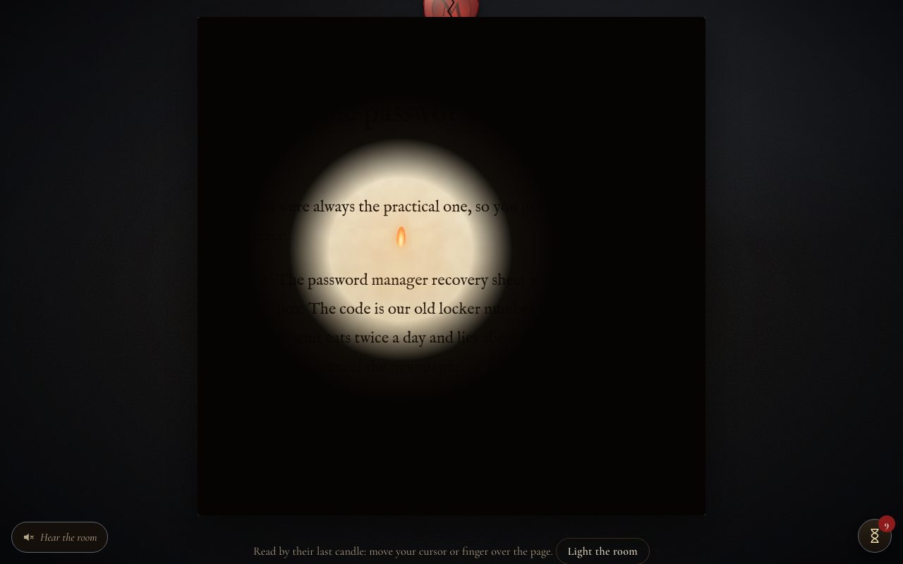

# Dead Man's Switch

**Write letters for the people you love, sealed until you can no longer check in.**

> **What no one else does**
> 1. **The recipient holds half the key.** In keepsake custody the vault never holds enough to read a letter, so not even we can.
> 2. **Any witness can veto.** A lost phone or a long holiday never sends a letter: one "they still live" stops the release.
> 3. **The room is the state machine.** Lit, guttering, out: the candle and the whole page show exactly where the vigil stands.
>
> *Twelve taps a year is the whole job.* Success is candles still lit after twelve months.

*The 60-second walk-through, as **Play the whole story** runs it: Mara's candle burns, a missed month turns the room green, a week later it goes out and her witness Silas confirms, and June breaks the seal and reads by Mara's own candle.*

**Costume Contest: the candle is the state machine, and the whole room wears it.** Built for Kiroween 2026. Not an account handover: a letter, in your words, that nobody (not even us) can open until the people you trust agree you are gone.

[Judge's 60-second path](#judges-60-second-path) · [Why not Google or Apple?](#why-not-the-tools-you-already-have) · [The costume](#the-costume) · [Built with Kiro](#built-with-kiro) · [Features](docs/FEATURES.md) · [Running and testing](docs/RUNNING.md) · [Architecture](docs/ARCHITECTURE.md) · [Kiro log](KIRO-LOG.md) · [Changelog](CHANGELOG.md)

> ### Judge's 60-second path
>
> `npm install && npm run demo`, open http://localhost:3140 and press **▶ Play the whole story**: a captioned, hands-off run from a lit candle to a letter read by candlelight, in about 40 seconds. To drive it yourself instead:
>
> 1. Press **Try a demo vigil**. You are Mara, with two sealed letters and two witnesses.
> 2. Open the **Time machine** (the hourglass) and press **+30 days**: the flame gutters, the tab reads "(!) Your candle gutters" and the grace email lands in the outbox.
> 3. Press **+7 days**: the candle goes out. In the outbox, open the first **Witness asked** and confirm as Silas.
> 4. Open **Letter released** for June and break the seal. The letter decrypts in that tab, once, beside Mara's own candle.

## Why it matters

- **[3,072,666 people died in the U.S. in 2024](https://www.cdc.gov/nchs/fastats/deaths.htm)** (CDC), and **[only 46% of U.S. adults have a will](https://news.gallup.com/poll/351500/how-many-americans-have-will.aspx)** (Gallup, 2021). Not one of those wills tells your sister where the password sheet is.
- **[29.8 million U.S. small businesses have no employees](https://advocacy.sba.gov/wp-content/uploads/2026/02/FINAL_FAQsAboutSmallBusiness_2026_012826.pdf)** (SBA Office of Advocacy, 2026, from 2022 data). In each one, a single person holds every account.
- **People already pay for a place to leave things behind:** [Everplans Premium](https://www.everplans.com/pricing) is $99.99 a year, [Trustworthy](https://www.trustworthy.com/pricing) starts at $10 a month billed yearly, and [GoodTrust](https://mygoodtrust.com/pricing) lists $149 for a will or trust. Figures checked at each linked source on 2026-11-18.

**Who keeps a vigil:** Mara, 58, writing to her son and her best friend; Priya, a solo founder whose co-founder needs the recovery codes if she is in hospital when payroll is due; and Ruth, a hospice social worker who hands families a printed keepsake kit.

## Why not the tools you already have?

| Tool | What it hands over | Who can read it first | Who checks before it goes | Works for |
|---|---|---|---|---|
| Google Inactive Account Manager | Google account data, plus one notice email | Google holds the data | No one: an inactivity timer decides | Google accounts only |
| Apple Legacy Contact | Apple account data | Apple holds the data | Apple, after a death certificate | Apple accounts only |
| Bitwarden Emergency Access | The whole password vault | No one (end-to-end encrypted) | Only you, by rejecting within a wait time | Bitwarden Premium users |
| deadmansswitch.net | Pre-written emails | Not stated on its site | No one: missed reminders release them | Any email address |
| [GoodTrust Future Messages](https://mygoodtrust.com/future-message) | Video, photo or text messages | GoodTrust stores them (AES-256; not stated as end-to-end) | No one: they go out on dates you choose | Email or your social accounts |
| [Everplans letters](https://www.everplans.com/blog/keep-things-private-until-after-youre-gone) (Sharing After Death) | A "Letters to Family & Friends" section of your plan | Everplans stores the plan | One deputy reports your death; only you can block it, by email, within up to 30 days | Everplans members and their deputies |
| [SafeBeyond](https://www.prnewswire.com/news-releases/safebeyond-launches-the-worlds-first-posthumous-message-delivery-platform-300150111.html) | Messages, videos and files on a date, event or place | Stored in its cloud; encryption not stated | Trustees you name report your death | Its mobile app (safebeyond.com no longer resolves) |
| **Dead Man's Switch** | **A sealed letter for each person, in your words** | **No one in keepsake custody: the recipient holds half the key** | **Witnesses you name; any one of them can stop it** | **Any browser, any email** |

The big platforms hand over accounts. This hands over the words, and even we cannot read them. The three posthumous-message rows were checked at each product's own pages on 2026-11-19.

## The costume

| | |
|---|---|
|  |  |
|  |  |

The app wears its own state. The candle is the state machine, drawn, and the whole room follows it:

| Stage | What you see | What it means |
|---|---|---|
| Alive | A full candle, a steady flame, warm embers drifting | You checked in; nothing will be sent |
| Reminder | The wax burns down with the days left | Your check-in is due soon |
| Grace | The flame gutters, the glow halves, the embers slow, and the browser tab reads "(!) Your candle gutters" | You missed it; reminders keep coming |
| Witnesses asked | The candle is out and smoking; the room goes near black, cold and smoky | The people you trust are asked to confirm |
| Check-in | A match strike: the wick flares, the wax grows back, sparks leave the seal, the warmth returns | Everything is cancelled and the witnesses stand down |
| Released | A cracked seal, a moonlit room, and a letter read by the light of one candle | Each recipient opens their letter once |

Wax seals carry each recipient's initial, the check-in is a seal you press, and the recipient breaks a seal to read beside the author's own candle. Every fact the room shows is also stated in text and announced to screen readers; under reduced motion each change is instant.

## Plans, after Kiroween

- **Free** for one vigil with a few letters. Today every vigil is free.
- **Keepsake, $39 for ten years of vigil, then $5 a year:** more letters and witnesses, and a printed keepsake kit, one card per person. Hospice social workers and estate attorneys are the referrers.
- **Founder, a flat $8 a month per business, with up to 5 recipients:** a bus-factor plan where the letter is the runbook for the accounts only one person holds.
- **Projection, not a result:** if 1% of the 29.8 million solo businesses kept a founder vigil at $96 a year, that would be about $286 million a year.
- **Built to outlive us:** MIT-licensed and self-hostable, a stated sunset policy, a sealed export of every letter, and [`offline-open.html`](src/web/public/offline-open.html), which opens a letter and its keepsake with no server. Details in [docs/FEATURES.md](docs/FEATURES.md).

## Run and test it

Node 20 or newer. `npm install && npm run demo` serves everything on http://localhost:3140 with the time machine on; `npm run check` runs the typecheck, the unit suite, a production build and Playwright. Current suite: <!-- test-counts -->120 unit tests in 19 files, all passing, and 31 end-to-end runs (desktop and phone) in 4 Playwright files.<!-- /test-counts -->

The end-to-end suite seals a letter, lets the candle go out, confirms as a witness and opens the letter once in a fresh browser, and runs an axe WCAG 2.2 AA audit of every page and state. More in [docs/RUNNING.md](docs/RUNNING.md).

## How it is built

React and Vite in the browser, a Hono API, and a pure state machine shared by both, with the clock, the store and the mailer behind ports. It runs on Node locally and is written for the Cloudflare Workers free plan. Each letter gets a random key K, split into a keepsake half A that the recipient holds and a vault half B = K xor A that the server holds. See **[docs/ARCHITECTURE.md](docs/ARCHITECTURE.md)**.

## Built with Kiro

The initial build and the security hardening were done with Claude Code, working from the Kiro steering files and a spec written in Kiro's format. Kiro then reviewed the spec against the code, rewrote every criterion in EARS form, and built two tasks itself. Every call is in **[KIRO-LOG.md](KIRO-LOG.md)** with its prompt, duration, credits, files and test results.

| Kiro feature | Where | What it produced | Tests right after that pass |
|---|---|---|---|
| Spec review (Pass 2) | [`.kiro/specs/switch-lifecycle`](.kiro/specs/switch-lifecycle) | EARS criteria for Requirements 1 to 11, 12 new gap tasks, tasks checked only where a test exists | Vitest 79 of 79, Playwright 11 of 11, 0 axe violations |
| Spec-driven tasks (Pass 2) | `tasks.md` 8.6 and 6.11 | The `RateLimiter` port and both adapters; a single-glyph wax seal; three test files | Same run |
| Steering | [`.kiro/steering`](.kiro/steering) | Five files: product, tech and structure rules every session reads first, plus `crypto.md` and `a11y.md`, which load only when a matching file is in play (added after Pass 2) | n/a |
| Hooks | [`.kiro/hooks`](.kiro/hooks) | Four hooks in the v1 schema that Kiro IDE 1.x and CLI V3 share: unit tests on save, typecheck and tests before the agent stops, a crypto-custody review when `crypto.ts` changes, and a spec-drift review after each spec task | `tests/unit/kiro-config.test.ts` checks every trigger, matcher and command |
| Custom agent | [`.kiro/agents/dead-mans-switch.json`](.kiro/agents/dead-mans-switch.json) | A builder agent that loads the steering and specs, works one task per session, and lists the open spec tasks when a session starts (`scripts/open-tasks.mjs`) | Same test |
| MCP | [`.kiro/settings/mcp.json`](.kiro/settings/mcp.json) | AWS Documentation and Context7 servers, so API details are checked against current docs | Same test |
| Prompts | [`.kiro/prompts`](.kiro/prompts) | The exact prompts, so each call can be re-run | n/a |

## Accessibility

WCAG AA contrast, full keyboard use with a skip link and visible focus, every state stated in text beside the candle, status changes announced, and `prefers-reduced-motion` respected.

## License

MIT © 2026 Stubborn Otter Software
